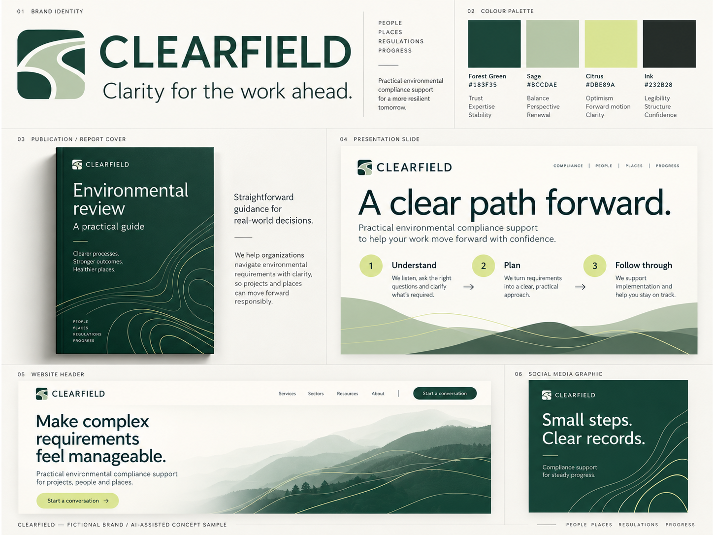

# Freelance demonstration samples

## Clearfield — environmental compliance concept

**Fictional, AI-assisted concept sample. Not commissioned client work.** Prepared on 31 October 2026 to demonstrate one possible visual direction for an approachable environmental consultancy.

The board explores a consistent palette and visual motif across a report cover, presentation slide, website header and social graphic. Clearfield is a placeholder name, not the identity of a prospective client. The artwork was generated with AI and visually reviewed; it is a raster concept board, not an editable template package or a final logo master. It makes no certification, legal-compliance or environmental-performance claims about a real business. Name and trademark clearance have not been performed.

A commissioned adaptation would use the client's supplied logo, approved copy and references. Scope, editable deliverables, price, deadline and revision allowance would be agreed separately before work begins.
